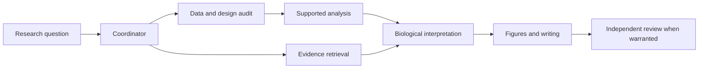

# Biology Agent

**A study-design-aware research coordinator for bioinformatics and omics.**

[中文介绍](README.zh-CN.md) · [Architecture](docs/architecture.md) · [Try the example](examples/README.md) · [Validation record](docs/validation.md)

Biology Agent turns a biological question into a sequence of inspectable research tasks: establish the experimental design, check the inputs, choose an appropriate analysis, evaluate the evidence, and communicate what the results support.

It is an **instruction-based Codex skill**. The repository contains the coordination protocol, domain guidance, a synthetic example, and a packaging validator. The host provides the model, tools, and optional subagents; the project does not ship a standalone orchestration service or a preconfigured sequencing pipeline.

## The problem

A plausible workflow can still support an invalid conclusion. Thousands of cells do not replace independent donors. Batch integration cannot identify a condition effect when condition and batch completely overlap. A pathway enrichment result does not establish a causal mechanism.

This project makes those decisions explicit before analysis and preserves their consequences through interpretation and writing.

## What it coordinates

| Work | Design focus |
| --- | --- |
| Study design and data audit | Independent replicates, sample metadata, paired observations, confounding, matrix meaning |
| Analysis planning and execution | Data-appropriate methods, traceable inputs, parameters, environments, and execution status |
| Biological interpretation | Claim-to-evidence correspondence, alternative explanations, and limits of inference |
| Figures and writing | Agreement between results, figures, captions, methods, and conclusions |
| Independent review | Challenges to consequential claims and concrete, locatable corrections |

The reference guidance covers bulk RNA-seq, single-cell/single-nucleus RNA-seq, spatial omics, chromatin/variant analysis, proteomics/metabolomics, and multi-omics integration. Coverage means written decision guidance; each real analysis still requires suitable data, methods, tools, and verification.

## Coordination model



Roles are selected for the task. Independent literature work and data inspection can run in parallel when the host supports subagents. Inference depends on the design audit, and result writing depends on verified results. Simple questions can be answered directly. See [architecture and handoffs](docs/architecture.md).

## Quick start

Install into a new personal skill directory:

```bash
mkdir -p ~/.codex/skills
git clone https://github.com/Juncheng-Muk/biology-agent.git ~/.codex/skills/biology-agent
```

If that directory already exists, use the existing installation or review it before updating; cloning does not replace it.

In a Codex chat with this skill available, invoke it with a concrete question and data location:

```text
$biology-agent
Review my single-cell project before differential expression.
Data: /path/to/project
Question: Does condition B differ from condition A within each cell type?
First inspect the sample design, metadata, and matrix layers.
Then propose an analysis and explain what conclusions the design can support.
Respond in English.
```

The skill defaults to Chinese and follows the requested language. For other hosts, the Markdown can be supplied as task guidance; tool access and delegation require host-specific integration. The optional specialist skills mentioned in `SKILL.md` are not bundled dependencies.

## A small example with a consequential decision

The [synthetic design audit](examples/README.md) provides six fictional donors, three per condition, and 50,000 invented cell counts. All condition A samples belong to batch 1, and all condition B samples belong to batch 2.

The useful output is a decision about the study: donor-level replication is necessary, but neither pseudobulk nor integration can resolve the complete condition–batch confounding. No expression matrix or biological findings are supplied. The example is runnable as an agent conversation without downloading a scientific dataset.

See the [recorded manual trial and its limits](docs/validation.md). A single synthetic trial is evidence about that response, not a benchmark of real-data analysis accuracy.

## Repository map

```text
biology-agent/
├── SKILL.md                         # Coordination protocol and invocation rules
├── agents/openai.yaml               # Codex display metadata
├── references/                      # Conditional omics and evidence guidance
├── examples/confounded-design/      # Synthetic metadata and complete prompt
├── docs/                            # Architecture, trial record, and evaluation scope
├── scripts/validate.py              # Packaging, links, and example consistency checks
└── requirements-dev.txt             # Validator dependency only
```

To validate the repository in a dedicated Python environment:

```bash
python3 -m venv .venv
.venv/bin/python -m pip install -r requirements-dev.txt
.venv/bin/python scripts/validate.py
```

This checks the package and example inputs. It does not run an LLM, evaluate biological claims, or execute an omics pipeline.

## Project scope and development

The initial implementation was developed with AI assistance. Its technical focus is task decomposition, domain-specific research checks, explicit dependency management, and inspectable outputs. No patient-level data, paid service credentials, real-data benchmark scores, or claims of biological discovery are included.

Future work can extend the project with independently reviewed real-data case studies, repeated behavioral evaluations across models, and optional executable workflow adapters. These are directions for development, not implemented features.
