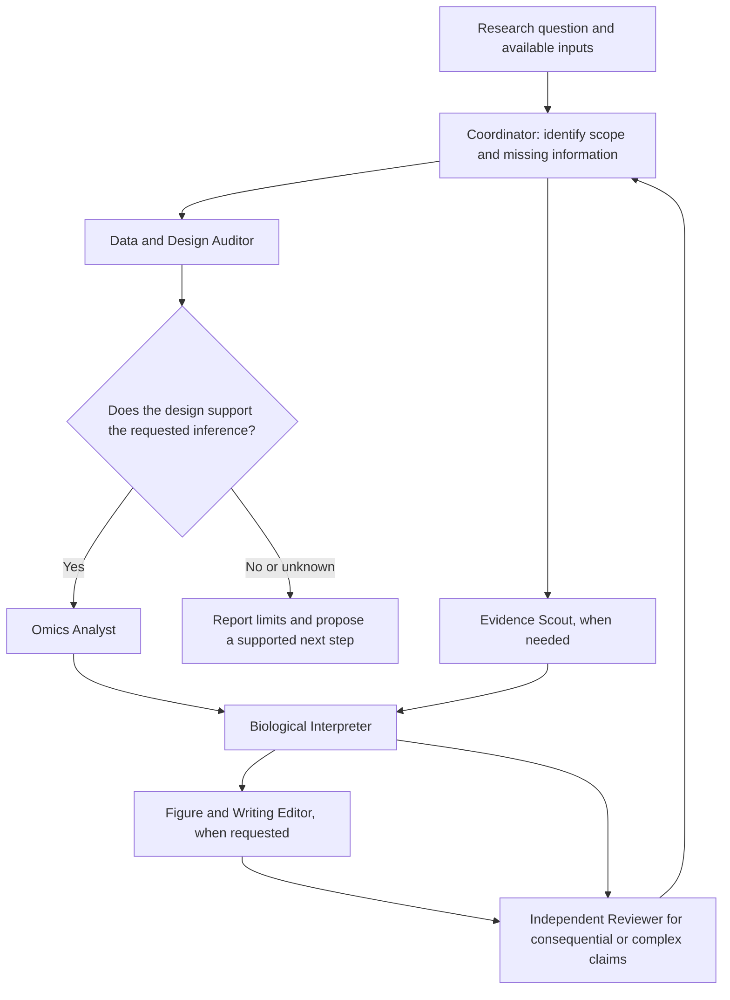

# Architecture

Biology Agent is an instruction-based research coordinator packaged as a Codex skill. Its core contribution is a set of explicit decisions about study design, task dependencies, evidence, and reporting. The host supplies the language model, file access, execution tools, and any subagent capability. This repository does not implement a separate agent runtime or bundle an executable omics pipeline.

## How a task moves through the system

This diagram describes dependencies, not an always-on sequence. A small question can be handled by the coordinator directly. Missing expression data can prevent differential expression while still allowing a useful metadata audit. An insufficient design can support descriptive work without supporting the requested population-level conclusion.

Literature work and input inspection can run in parallel. Statistical inference waits for the relevant study-design checks. Writing depends on verified results. Roles become actual subagents only when the host supports delegation and the task benefits from it; otherwise, the coordinator performs the work sequentially.

## Responsibility and handoff

| Role | Main responsibility | Handoff that another role can inspect |
| --- | --- | --- |
| Coordinator | Define the deliverable, choose roles, resolve conflicting findings | Scope, dependencies, input locations, constraints, and acceptance criteria |
| Evidence Scout | Retrieve and check literature or dataset records | Claim-to-source mapping, identifiers, accessible content, and limitations |
| Data and Design Auditor | Establish sample relationships and feasible comparisons | Input inventory, experimental units, confounding, and missing metadata |
| Omics Analyst | Plan or execute an appropriate analysis | Code, parameters, environment details, execution status, and result files |
| Biological Interpreter | Separate observed patterns from explanatory hypotheses | Supported interpretations, alternatives, and validation needs |
| Figure and Writing Editor | Present checked results in the requested format | Figures, captions, text, and traceable source results |
| Independent Reviewer | Challenge important conclusions and inspect artifacts | Locatable issues, their impact, and necessary corrections |

Delegated work receives an explicit output location. Concurrent agents should not modify the same analysis object. The coordinator resolves disagreements using evidence and method assumptions rather than counting agent votes.

## Research quality decisions

The skill emphasizes decisions that change whether a biological claim is defensible:

- **Experimental unit:** distinguish independent donors or animals from nested cells, spots, wells, or sections.
- **Identifiability:** identify when condition and batch effects cannot be separated by the study design.
- **Input meaning:** check whether a matrix contains raw counts, normalized expression, or an integrated representation before selecting a method.
- **Evidence level:** separate measured association, statistical support, biological interpretation, and causal hypotheses.
- **Execution state:** distinguish a proposed workflow, generated code, completed execution, and checked results.
- **Traceability:** preserve input provenance, stable identifiers, reference versions, transformation decisions, and the connection between results and figures.

These are instructions for the host agent, not guarantees enforced by a statistical engine. They need behavioral evaluation, appropriate tools, and domain review in actual research use.

## Repository components

| Component | Purpose |
| --- | --- |
| [SKILL.md](../SKILL.md) | Entry point, routing, role definitions, and shared constraints |
| [agents/openai.yaml](../agents/openai.yaml) | Display metadata and an example invocation prompt |
| [references/omics-analysis.md](../references/omics-analysis.md) | Conditional guidance for data types and analysis decisions |
| [references/evidence-and-interpretation.md](../references/evidence-and-interpretation.md) | Evidence handling, interpretation, and research writing |
| [examples/README.md](../examples/README.md) | A synthetic study-design example with review criteria |

The named specialist skills in the entry point are optional integrations and are not included in this repository. Without them, the coordinator can use the host's available tools to perform equivalent work. Method choice, package installation, compute availability, and database access remain properties of the user's environment.

## Evaluation scope

Repository validation can check packaging and links. A synthetic example can test whether an agent recognizes a specific design problem and reports its limits. Neither establishes analysis accuracy on real omics data, general reliability across models, or a biological discovery. This project does not claim a real-data omics benchmark score.
